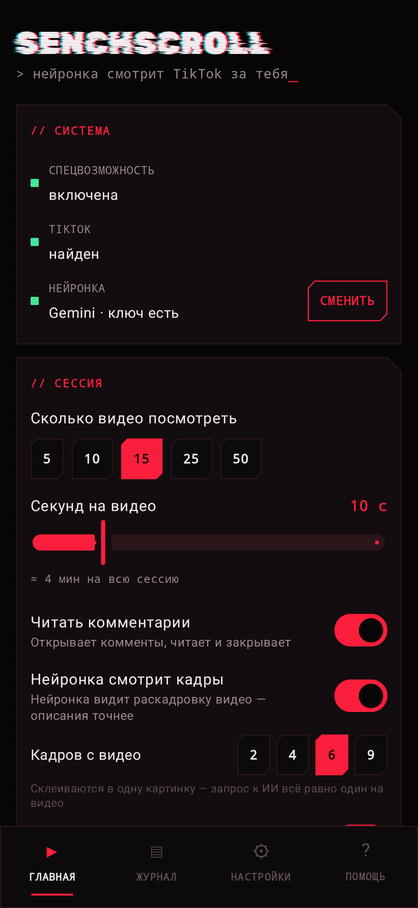
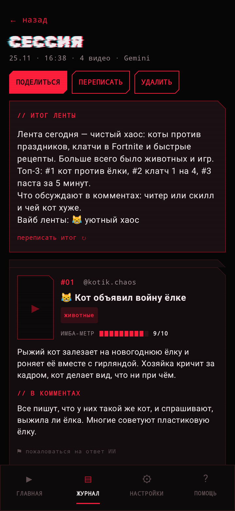

# SenchScroll — нейронка листает TikTok за тебя

Открываешь приложение и жмёшь «Запустить». Открывается TikTok, и дальше приложение листает ленту само: смотрит каждое видео, снимает раскадровку, открывает и читает комменты. Нейронка пишет журнал: о чём было видео, что думают в комментах, категория и имба-метр. В конце она подводит итог всей ленты.

 

## Установка
1. Скачай `SenchScroll.apk` из [Releases](https://github.com/senchsus/SenchScroll/releases) и установи. Если приложение уже вышло в F-Droid, можно поставить оттуда.
2. Возьми бесплатный ключ Gemini: https://aistudio.google.com/apikey. Вставь его в «Настройки».
3. Включи спецвозможность: Настройки телефона → Спец. возможности → Установленные приложения → SenchScroll.
   Если переключатель серый (Android 13 и новее), открой «О приложении» SenchScroll → ⋮ → «Разрешить ограниченные настройки».
4. На главной выбери, сколько видео смотреть, и нажми «Запустить».

## Нейронки
- Бесплатные ключи: Gemini, Groq, Mistral, OpenRouter.
- Платные ключи: Grok, Claude.

## Конфиденциальность
Текст с экрана, комменты и кадры уходят только в выбранную нейронку. Журнал хранится только на телефоне. Подробнее — в [PRIVACY.md](PRIVACY.md).

## Сборка
Команда `./gradlew assembleRelease`. Нужны Android SDK и JDK 17+.

## Лицензия
Код распространяется под GPL-3.0-or-later (см. [LICENSE](LICENSE)). Шрифт Rubik Glitch распространяется под SIL Open Font License (см. [LICENSES/OFL-RubikGlitch.txt](LICENSES/OFL-RubikGlitch.txt)).

Контакты: idaboba353@gmail.com · Telegram [@sigmamoggingchad](https://t.me/sigmamoggingchad)

Не связано с TikTok и ByteDance.
